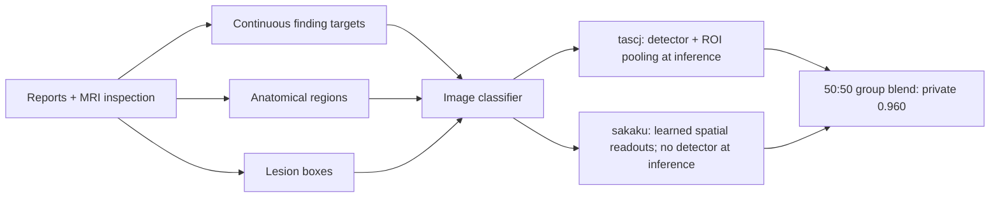

# RSNA Knee 2026: first-place spatial supervision

Reviewed 2026-10-25 from both Team Kangaroo authors. These are author-reported
experiments, not reproduced benchmarks. The live Kaggle API confirmed team
16672144 at private rank 1 / 0.960; authors `tascj0` and `liushuzhi` are its members.

## Primary sources and baseline

- [tascj's first-place writeup](https://www.kaggle.com/competitions/rsna-knee-abnormality-detection/writeups/1st-place-solution),
  published October 25, topic 752468 / writeup 121393.
- [sakaku's complementary first-place account](https://www.kaggle.com/competitions/rsna-knee-abnormality-detection/discussion/752474),
  published October 25. Describes the other half of the final blend.
- [Final notebook, version 361034054](https://www.kaggle.com/code/tascj0/knee-final-20261022?scriptVersionId=361034054),
  linked by the authors; this review does not claim a code reproduction.
- [Leaderboard](https://www.kaggle.com/competitions/rsna-knee-abnormality-detection/leaderboard).
  Team final: public 0.969 / private 0.960. Our best unselected private 0.943
  trails by 0.017; our official selected 0.942 trails by 0.018. The
  [earlier case study](rsna-knee-2026.md#sources-and-comparison-baseline) documents
  our submission audit and implementation sources. These gaps are not ablations.

## What they added beyond our approach

Our strongest submission reused public checkpoints and refined inference/blends;
our own training did not contribute to that stack. We already had physical crops,
multi-plane inputs and runtime gates. The useful additional tests are richer
supervision, shared-feature spatial readouts, and controlled backbone adaptation.

### Labels: evidence, confidence and downstream benefit

Annotation sessions inspected overviews and requested bounded additional slices,
windows and cross-sequence views. Outputs retained evidence identities and soft
probabilities. Geometry supplied candidate corresponding locations, not registered
anatomy. Reports were privileged training information, unavailable at test time.
The budgeted reader is a design pattern, not a recommendation for a particular
provider or permission to run paid annotation.

| Comparison | Reported result | Interpretation |
|---|---|---|
| sakaku: earlier multimodal labels → Astra, matched CoAtNet 224 | Public 0.922 → 0.935 | Strong downstream evidence for this label pipeline; not a comparison against report-only labels |
| tascj: base Astra → five-fold OOF learned reading guide on gold-58 | AUC unchanged at 0.936; log loss 0.329 → 0.307; confident errors 35 → 19 | Label quality has dimensions beyond AUC; guide folds do not undo earlier protocol tuning |
| Same guide trained and assessed on all 58 | AUC 0.943 | In-sample development result, not the OOF guide result |
| sakaku: backbone peak LR intervention | Public 0.936 → 0.944; gold 0.9283 → 0.9215 | Small expert set ranked the intervention oppositely; stopping duration also changed |
| sakaku: complete anatomy-aware package | Public 0.956 → 0.960; local difference inconclusive | Bundled spatial package, not an isolated loss gain |

Monitor proper probability scores and a defined confident-error diagnostic as well
as ranking. Fit calibration/learned guides inside training partitions and verify
their downstream effect. tascj fit a logit temperature on gold-58, making later
gold comparisons calibration-exposed. sakaku's flexible per-target label fusion
lost its apparent advantage under leave-one-out evaluation; final Mix5 used one
global recipe. Exact weights and model names are case-specific.

### Distinguish anatomy, pathology, absence and unknown

tascj annotated anatomical 3D ROIs for 751 studies / 4,092 series, then trained a
series detector (reported mean IoU 0.714 on 551 held-out series). His separate
lesion collection covered 1,800 studies / 111,029 per-slice boxes. These are
different supervision assets: a normal structure can have an anatomical ROI.

sakaku expanded coarse annotations with two study-disjoint detector folds. The
detector mAP50 values 0.952 / 0.944 measure agreement with machine annotations,
not expert anatomical accuracy. Detector OOF must also respect the downstream
classifier's outer holdout; two independent fold schemes alone do not prove that.

The slice-target records explicitly separated a positive anatomical region,
verified structural absence, and unknown. Empty detections, unrequested findings
and missing lesion annotations were not disease negatives. Accepted target/role
combinations and matched source identities gated spatial losses. In his triplets,
lesion supervision came from the center slice, with valid/distinct/undropped
slice checks; transforms moved images and boxes together. Lesion eligibility
stayed fixed across training-label comparisons.

Early localization output remained similar after image substitution despite
fluent explanations. This motivated image-grounding checks: overlays, replacement
images, laterality, background false positives and coverage. A report-consistent
diagnosis is insufficient evidence for accurate coordinates.

### Two deployment choices on shared features

| Branch | Spatial mechanism | Test-time requirement |
|---|---|---|
| tascj | ROI-overlap pooling, then attention initialized to uniform weights inside each box | Side resolution, ROI detector, crop, classifier, series averaging |
| sakaku | Global pooling plus a learned target-attention residual initialized near global pooling | MRI classifier only; no annotation lookup or detector pass |

tascj's lesion and report-embedding heads were training-only and removed at
inference. sakaku's annotation assets were training-only, but his lesion-evidence
head **remained** in the prediction path on the same backbone features. Its
residual was centered using training-only prevalence. Do not describe every
lesion head as inference-free or drop a head that contributes to final logits.

At 256 px, tascj's cumulative gold-58 AUC progression was 0.9319 → 0.9330 (ROI
pooling) → 0.9386 (112 mm crop) → 0.9396 (attention) → 0.9410 (label calibration)
→ 0.9432 (lesion **and** report heads together). OOF hard-reference AUC progressed
0.9586 → 0.9638. These are development metrics; calibration used gold-58, the last
step bundles two heads, and none of these increments is a private-LB ablation.

### Validation, diversity and deployment

- tascj's five-fold study split kept gold studies outside classifier fitting but
  used them in annotation/calibration development. He selected a label reference
  after studying 20–30 public-LB results. sakaku selected one of ten development
  folds by historical LB correlation: 435 held-out studies, not ten-fold CV.
- sakaku kept a common three-source validation reference while changing training
  recipes. His SoftAUC weights ordered **distinct** study pairs by
  `q_i * (1-q_j)` with half credit for tied predictions. Its scale is different
  from hard-label AUC; both the reference and fold selection remain biased.
- sakaku's three full-data models trained on all 4,407 studies, including gold-58,
  with EMA epochs 15–19 averaged. This group scored 0.957 private in a
  post-competition check. It supplied half the final blend; the other half was
  tascj's group. His five-fold ConvNeXt-T family scored 0.958; his separate
  efficiency entry used one classifier checkpoint and scored 0.954, still with
  an ROI detector. Neither is the complete winning system.
- Diversity included label recipes and acquisition inputs as well as backbones.
  tascj's six-channel variants resampled plane × fat-suppression inputs into
  patient coordinates; he reported greater gain than backbone blending without
  a numeric isolated delta. Treat registration/coverage and marginal value as
  experiments. He found no benefit from his study-level/2.5D/3D variants; that
  does not generalize to the team's successful other branch.
- The efficiency notebook reportedly took 230 seconds on a 1,200-training-study
  rehearsal, with TensorRT, C++ decoding and fluid-sensitive-only reads. That is
  not the runtime of the final ensemble or a hidden-test guarantee. I/O varied
  roughly 30 to over 500 MB/s. Profile cold reads and tail latency, not just GPU
  compute. Skipping 41% of data was specific to that branch's inputs.
- sakaku cached normalized uint16 volumes plus geometry while retaining raw
  DICOMs. That cache was quantized, not lossless. Checkpoints were bound to their
  exact preprocessing; cold reload and packaged/training prediction checks caught
  deployment mismatches.

## Practical order for our next competition

1. **Small annotation pilot, before full training:** compare frozen label recipes
   at fixed training settings; record probability quality and student transfer.
2. **Spatial pilot, before adding backbones:** audit a small set of anatomy/lesion
   annotations, encode region/absence/unknown, and compare shared-feature readouts
   with a matched global baseline. Separately test training-only report supervision.
3. **Training and deployment gates:** test backbone adaptation with a matched
   update budget; preserve an outer audit outside prompt/calibration/fold selection.
   Measure input/supervision diversity against extra backbones under cold-I/O runtime.

No numerical gain or first-place outcome is promised. Second/third place are not
covered here; retain the scheduled top-three review until those are reviewed.
