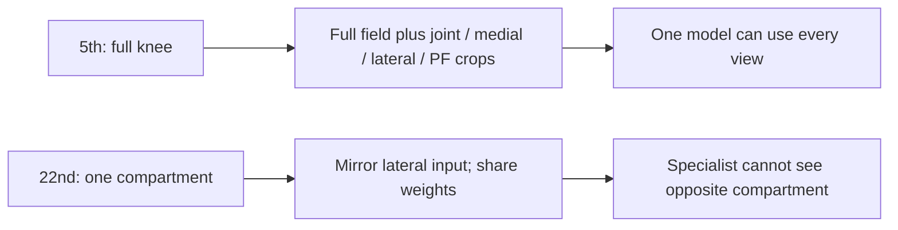
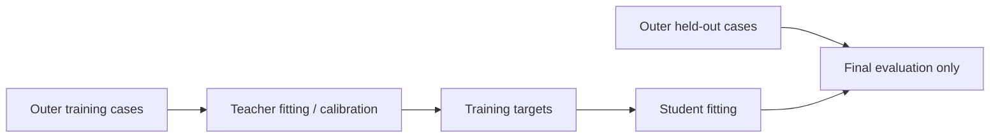

# RSNA Knee 2026: lessons from 5th and 22nd place

Reviewed 2026-10-24. Scope: two published solution writeups, not the top three.
Technique, runtime and intermediate-score claims are author-reported and have
not been reproduced. The reviewed 5th-place post marks code/weights coming soon;
the reviewed 22nd-place post links no training code.

## Sources and comparison baseline

- **[5th-place solution](https://www.kaggle.com/competitions/rsna-knee-abnormality-detection/writeups/5th-place-solution)**:
  RB & Matheus & Tucker & Tony; Rashmi B, Matheus, Tucker Arrants and Tony Li.
  Published 2026-10-23 21:59 UTC. Kaggle topic 752190 / writeup 121229.
- **[22nd-place solution](https://www.kaggle.com/competitions/rsna-knee-abnormality-detection/writeups/22nd-place-solo-gold-solution)**:
  matsurih (`matsurihime`), solo. Published 2026-10-23; reviewed snapshot updated
  16:52 UTC. Topic 752052 / writeup 121121.
- **[Official leaderboard](https://www.kaggle.com/competitions/rsna-knee-abnormality-detection/leaderboard)**:
  saved 2026-10-23 data corroborates team 16668884 at private #5 / 0.958 and team
  16758675 at private #22 / 0.954. Public scores were 0.969 and 0.965 respectively.
- **[Our final-model report](https://github.com/yassineAlouini/rsna-knee/blob/74e0d2efa32dab73f35a54ead9578bda9b0bbb7c/docs/FINAL_MODELS_REPORT.md)**,
  **[fold builder](https://github.com/yassineAlouini/rsna-knee/blob/74e0d2efa32dab73f35a54ead9578bda9b0bbb7c/src/make_folds.py)**,
  and **[experiment wrap-up](https://github.com/yassineAlouini/rsna-knee/blob/74e0d2efa32dab73f35a54ead9578bda9b0bbb7c/docs/WRAPUP_2026-10-20.md)**:
  our final community-checkpoint stack reached public 0.958 / selected private
  0.942, rank #621. Our own trained blends reached public 0.943–0.944 and were
  excluded from the strongest stack. These are different baselines.

An account submission-history check on 2026-10-24 found private 0.943 in several
unselected runs among 38 submissions (representative: 57373642, public 0.958).
Both selected finals, 57430271 and 57488336, scored private 0.942. Account history
requires account access and is not independent public evidence. Use 0.943 only
as a retrospective comparison, never as our official finish. The 22nd-place author
also reports an unselected 0.955 variant; the official final remains 0.954.

## The evidence that changes experiment choices

| Experiment or observation | Reported result | What it supports / limitation |
|---|---|---|
| 5th: CoAtNet report-label calibration, same training/inference recipe | Private 0.916 → 0.926 | Test training-target meaning and calibration; separate from the EfficientNet progression below |
| 5th: teacher-fused labels **and** 17 → 25 epochs | Private 0.946 → 0.954 | A bundled +0.008; does not isolate labels |
| 5th: add anatomical crops, same EfficientNetV2-M/label recipe | Private 0.954 → 0.957 | Test full-field plus higher-resolution regions with matched controls |
| 5th: ConvNeXt Base regional family / final ensemble | Both private 0.958 | Strong base first; equal three-decimal scores do not establish exact equality |
| 5th: specialists on weaker versus stronger bases | +0.002 private on weaker base; around 0.001 or less on regional base | Marginal value depends on the base and needs retesting |
| 5th: site seen during training | +0.019 local AUC against report labels, without an expert-case gain | Audit site shortcuts; this is not a demonstrated +0.019 clinical/leaderboard gain |
| 22nd: main-model label change | +0.0031 local proxy / +0.003 public | Evidence for testing stronger supervision; private isolated gain not reported here |
| 22nd: plane/main-model rank correlations | 0.86–0.89 | Screen complementary views, then measure the ensemble gain |
| 22nd: post-hoc medial/lateral correction | −0.007 public | A warning about that intervention, not proof that every decoupling approach fails |
| 22nd: final acquisition/embedding revision | Rounded public/private unchanged; hiding attributes costs about 0.0001 locally | Robustness benefit is plausible; a large isolated score gain is not established |

The stand-alone families are fold averages, not one checkpoint: 5th-place M1 uses
five EfficientNetV2-M folds (private 0.957), M3 five ConvNeXt Base folds (0.958),
and the 22nd-place main CoAtNet family five folds (0.946).

## Two anatomical experiments, not one rule

The 5th-place bone locator was trained on 1,200 competition series with
agent-assisted femur/tibia/patella masks. An 80 mm crop at 384 px represents about
0.21 mm/pixel versus 0.39 for a 150 mm field. This preserves local detail while
retaining full context. The 22nd-place design restricts visible anatomy to reduce
a suspected shortcut. Its final lateral OA prediction assigns 74% weight to one
compartment model, but the writeup does not isolate a crop-only positive gain.

Our final R6/S6 components already included anatomical views. A useful lesson is
to test a more specific input hypothesis in our own training, not merely to add
any crop or forbid access to context for all findings.

## Validation: audit more than the row's OOF tag

The 5th-place team held out 20 hospital-like clusters but explicitly acknowledges
teacher-label leakage: a teacher producing student-training targets could have
trained on the student's validation fold. Cross-fitted expert calibration does
not remove that path. Their report-label CV and repeatedly used 58 expert cases
were development diagnostics.

The 22nd-place team selected on 4,342 OOF predictions scored against a common
image-reading reference, with preregistered criteria and split-half checks.
That larger proxy retains teacher errors and selection bias; it is not new
clinical ground truth. Our own split grouped duplicate reports and stratified
scanner proxies, which does not establish unseen-site transfer. The reused final
checkpoints have their own training histories.

Construct competition-trained teachers and any inner cross-fitted targets inside
outer training data; keep the outer holdout out of calibration and target selection
as well as student training. Preserve an independent expert audit where feasible.

## Runtime and resources

5th place shared decoding, segmentation and crops across M1–M3, reused M3's early
features for lateral-meniscus fine-tunes, and used stage deadlines with alternate
studies on two T4 workers. Reported inference was 2 h 19 min for M1, 2 h 57 min for
M3 and 8 h 18 min for the ensemble. Shared preprocessing reportedly saved about
42% of one base model's GPU time.

22nd place shared decoding, overlapped segmentation/cropping with inference and
split models over two T4s. They report 56 networks fitting under nine hours while
61 were unreliable; training used up to 24 RTX 4090s simultaneously. Our roughly
6.7-hour projection included margin. Those measurements, projections and training
budgets are not interchangeable, and no network count is a reusable target.

## Negative evidence to retain

- The 22nd-place crop-derived lateral labels improved gold-58 agreement without
  improving trained models or public scores. Small-set label AUC alone is an
  insufficient gate.
- Their apparent synovitis/effusion over-coupling weakened after comparing binary
  labels with similarly binarized predictions, rather than continuous correlation.
- Their fluid feature stopped adding value after the base labels improved.
  The 5th-place specialists also added less after stronger regional inputs.
- Only one lateral-meniscus variant passed among 40 short fine-tunes in 5th place.
  Screening many variants still requires an independent confirmation.
- 5th place used probability averages followed by successive rank stages;
  22nd place used probability averages. This evidence contradicts an absolute
  requirement to rank-blend every AUC ensemble. Compare matched held-out results;
  repeated re-ranking cannot generally be flattened into one probability average.

## Three portable next experiments

1. Audit clinical definitions/missingness; compare label recipes at fixed epochs,
   then vary training duration separately. Keep teacher/calibration lineage clean.
2. Compare full-field versus full-field-plus-regions; independently test one
   restricted-compartment specialist. Audit orientation and crop coverage.
3. Compare one view/finding specialist with another same-view model under a fixed
   end-to-end runtime budget. Retest its value after base-model improvements.

These are proposed experiments, not guaranteed gains. The papers do not causally
attribute our entire 0.015/0.011 retrospective-best gaps to any isolated change.
